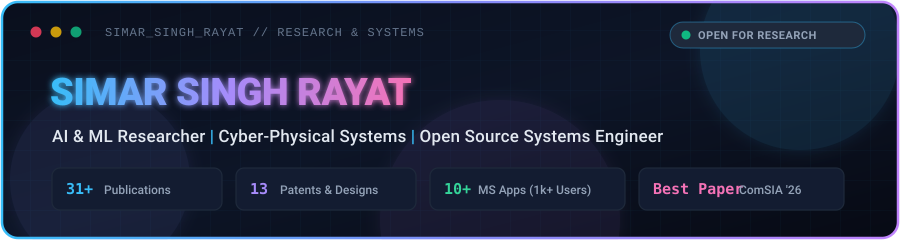

<!-- ========================================================================= -->
<!-- HEADER & ANIMATED BANNER                                                  -->
<!-- ========================================================================= -->

  

<!-- Animated Dynamic Typing Headline -->

  

<!-- Academic & Professional Identity Badges -->

  
  
  
  
  
  
  

  

<!-- ========================================================================= -->
<!-- WELCOME & ABOUT ME                                                        -->
<!-- ========================================================================= -->
<table>
  <tr>
    <td width="30%" align="center" valign="middle">
       
      <b>⚡ Pixel Mascot &amp; Co-pilot</b>
    </td>
    <td width="70%" valign="top">
      <h3>👋 Hi there! I'm Simar Singh Rayat</h3>
      

        I am a research-driven Computer Science undergraduate specializing in <b>Artificial Intelligence &amp; Machine Learning</b> at <b>Graphic Era Hill University</b>, Dehradun (Graduating June 2027). My research bridges fundamental algorithmic innovation with hardened cyber-physical implementation.
      

      

        My trajectory spans <b>literature-driven problem formulation</b>, <b>mathematical &amp; probabilistic modeling</b>, <b>distributed microservice architecture</b>, and <b>rigorous experimental validation</b>.
      

      <ul>
        <li>🔬 <b>Funded Research Fellow:</b> AI-assisted malware detection at LIAASSE Lab, <i>ENSA Fez – Université Sidi Mohamed Ben Abdellah (USMBA)</i>, Morocco.</li>
        <li>💡 <b>Intellectual Property:</b> 10 Published Patent Applications + 3 Granted Design Registrations with the Indian Patent Office.</li>
        <li>🌐 <b>Open-Source Architect:</b> Founder &amp; creator under <b>@KILZSNIPPET</b>, publishing utility &amp; security software on the <b>Microsoft Store</b> (10+ apps, 1,000+ users each) and <b>Chrome/Edge Extension Stores</b> (15+ extensions).</li>
      </ul>
    </td>
  </tr>
</table>

  

<!-- ========================================================================= -->
<!-- IMPACT AT A GLANCE (KEY METRICS)                                          -->
<!-- ========================================================================= -->
<h2 align="center">📊 Research &amp; Engineering Impact at a Glance</h2>

  
  
  
  
  
  

<table align="center" width="100%">
  <thead>
    <tr align="center">
      <th>📚 Academic Output</th>
      <th>💡 Patents &amp; IP</th>
      <th>💻 Production Systems</th>
      <th>🏆 Key Distinctions</th>
    </tr>
  </thead>
  <tbody>
    <tr>
      <td>
        • <b>1 Q1 SCI Journal Article</b> (Corresponding Author, <i>IF 4.1</i>) 
        • <b>20 Conference Papers</b> (IEEE, Springer, all Scopus) 
        • <b>10 Book Chapters</b> (Springer Nature, CRC Press, Bentham)
      </td>
      <td>
        • <b>3 Granted Design Registrations</b> (Govt. of India) 
        • <b>10 Published Patents</b> (ESP32, GNSS, IoT, AI Thermal) 
        • <b>Novel Architectures:</b> Hardware, Swarms &amp; Deep Learning
      </td>
      <td>
        • <b>10 Microsoft Store Apps</b> (1,000+ users each) 
        • <b>15 Edge/Chrome Extensions</b> active worldwide 
        • <b>KILZSNIPPET YouTube:</b> Technical &amp; AI Walkthroughs
      </td>
      <td>
        • <b>Best Paper Award:</b> ComSIA 2026 (UAV Swarm Defense) 
        • <b>Top Student Research Award:</b> Sigma Xi iFoRE 2025 
        • <b>Youngest Researcher Recognition:</b> GEHU
      </td>
    </tr>
  </tbody>
</table>

  

<!-- ========================================================================= -->
<!-- CORE RESEARCH THREADS                                                     -->
<!-- ========================================================================= -->

<h2>🔬 Core Research Thrusts</h2>

<table>
  <tr>
    <td width="50%" valign="top">
      <h4>🤖 1. Explainable AI, GenAI &amp; RAG Systems</h4>
      

        Building transparent, trustworthy neural architectures. Developing Retrieval-Augmented Generation (RAG) frameworks for large-scale patent claim mapping, autonomous software bug triaging, and multimodal generative forensics (detecting diffusion/GAN artifacts).
      

      <code>LLMs</code> • <code>RAG</code> • <code>Vision Transformers</code> • <code>XAI</code> • <code>GNNs</code>
    </td>
    <td width="50%" valign="top">
      <h4>🛡️ 2. Threat Intelligence &amp; Malware Defense</h4>
      

        Proactive cybersecurity frameworks fusing static/dynamic APK telemetry, network graph reasoning, and deep learning for zero-day Android malware detection. Designing cryptographic defense against C2 hijacking in distributed drone swarms.
      

      <code>Malware Analysis</code> • <code>Threat Feeds</code> • <code>UAV Defense</code> • <code>Fernet Crypto</code>
    </td>
  </tr>
  <tr>
    <td width="50%" valign="top">
      <h4>⚛️ 3. Quantum Machine Learning (QML)</h4>
      

        Investigating hybrid edge-cloud Quantum Support Vector Machines (QSVM) and Variational Quantum Circuits (VQC) for ultra-fast hyperspectral anomaly detection and dual-level risk assessment in mission-critical IoT-enabled cloud infrastructures.
      

      <code>QSVM</code> • <code>Variational Circuits</code> • <code>Quantum Anomaly Detection</code>
    </td>
    <td width="50%" valign="top">
      <h4>⚡ 4. Embedded IoT &amp; Cyber-Physical Systems</h4>
      

        End-to-end hardware prototyping using ESP32, Raspberry Pi, and custom sensor arrays. Designing low-latency edge inference nodes for bus occupancy telemetry, single-board thermal cooling, and intelligent power management.
      

      <code>ESP32</code> • <code>Raspberry Pi 5</code> • <code>Edge AI</code> • <code>Sensors</code> • <code>PCB Design</code>
    </td>
  </tr>
</table>

  

<!-- ========================================================================= -->
<!-- FLAGSHIP PROJECTS                                                         -->
<!-- ========================================================================= -->

<h2>🚀 Flagship Engineering &amp; Research Systems</h2>

<table>
  <thead>
    <tr>
      <th>System</th>
      <th>Architecture &amp; Core Highlights</th>
      <th>Quantified Benchmark / Impact</th>
    </tr>
  </thead>
  <tbody>
    <tr>
      <td>
        <b>🧠 PatentMind</b> 
        Generative AI for Patent Analytics
      </td>
      <td>
        • <b>Stack:</b> <code>RAG</code>, <code>FastAPI</code>, <code>Argo Workflows</code>, <code>PostgreSQL</code>, <code>Vector DB</code>, <code>Transformers</code> 
        • Retrieval-augmented intelligence engine for automated prior-art discovery, semantic claim decomposition, and AI-assisted invention-disclosure drafting. 
        • End-to-end orchestration via Argo microservice pipelines. <i>Related paper: [C20]</i>.
      </td>
      <td>
        🎯 <b>91.8%</b> Overlap Detection 
        🎯 <b>93.2%</b> Claim Matching 
        ⚡ <b>72%</b> Review Effort Reduction
      </td>
    </tr>
    <tr>
      <td>
        <b>🛡️ CyberGPT-Android</b> 
        LLM Threat Intelligence Platform
      </td>
      <td>
        • <b>Stack:</b> <code>LLMs</code>, <code>FastAPI</code>, <code>Argo Workflows</code>, <code>PostgreSQL</code>, <code>Static/Dynamic Analysis</code> 
        • Deep framework coupling LLM contextual reasoning with real-time Android telemetry (permissions, API calls, network behavior) to generate human-readable attack narratives and automated forensic security briefs.
      </td>
      <td>
        🎯 <b>94.1%</b> Malware Accuracy 
        🎯 <b>92.7%</b> F1-Score 
        ⏱️ <b>64%</b> Investigation Time Saved
      </td>
    </tr>
    <tr>
      <td>
        <b>🔬 MedGuard-Diffusion</b> 
        Synthetic Medical Image Forensics
      </td>
      <td>
        • <b>Stack:</b> <code>GANs</code>, <code>Diffusion Models</code>, <code>Vision Transformers</code>, <code>CNNs</code>, <code>XAI</code> 
        • Multimodal diagnostic forensics engine detecting synthetic medical imaging generated by modern diffusion and adversarial networks. Generates explainable pixel saliency evidence maps for clinical practitioners.
      </td>
      <td>
        🎯 <b>93.5%</b> Detection Accuracy 
        🎯 <b>93.1%</b> F1-Score 
        🔍 <b>Explainable</b> Evidence Maps
      </td>
    </tr>
    <tr>
      <td>
        <b>🔐 Secure CFTP</b> 
        Cryptographic File Transfer Protocol
      </td>
      <td>
        • <b>Stack:</b> <code>Python</code>, <code>Fernet Cryptography</code>, <code>REST</code>, <code>QR Dynamic Pairing</code> 
        • Zero-install cross-device secure transfer system. Files are symmetrically encrypted on upload with Fernet, paired instantly via ephemeral QR tokens, and auto-purged from memory upon expiry.
      </td>
      <td>
        🔒 <b>Zero-Trust</b> Temporary Storage 
        📱 <b>Zero Install</b> Required 
        ⏱️ <b>Time-Bound</b> Token Expiry
      </td>
    </tr>
    <tr>
      <td>
        <b>🏦 Decentralised Banking MFA</b> 
        Next-Gen Authentication Research
      </td>
      <td>
        • <b>Stack:</b> <code>Applied Cryptography</code>, <code>Decentralized Auth</code>, <code>Distributed Ledgers</code> 
        • Ongoing research architecture designed to replace vulnerable static MPIN mechanisms in modern mobile banking applications with tamper-resistant cryptographic multi-factor challenge schemes.
      </td>
      <td>
        🛡️ <b>Anti-Brute-Force</b> 
        🔑 <b>No Centralized</b> PIN Storage 
        🔄 <b>Active</b> Research Thread
      </td>
    </tr>
  </tbody>
</table>

  

<!-- ========================================================================= -->
<!-- PRODUCTION SOFTWARE & OPEN SOURCE ECOSYSTEM                              -->
<!-- ========================================================================= -->

<h2>💻 Software Products &amp; Open Source Ecosystem (@KILZSNIPPET)</h2>

  Under my developer persona <b>KILZSNIPPET</b>, I ship production utilities, privacy tools, and developer enhancements used daily by thousands of users across Windows, Linux, and modern web browsers.

<table>
  <tr>
    <th width="50%">🪟 Microsoft Store Applications (1,000+ Users Each)</th>
    <th width="50%">🌐 Edge &amp; Chrome Web Store Extensions (15+ Published)</th>
  </tr>
  <tr>
    <td valign="top">
      <ul>
        <li>📲 <b>MOBILE2PC:</b> Encrypted, QR-session direct file sharing between PC and mobile devices without network exposure.</li>
        <li>📚 <b>Reference Finder:</b> Academic utility enabling researchers to pinpoint authentic, peer-reviewed scholarly literature.</li>
        <li>🎙️ <b>Voice Note Memo:</b> Privacy-preserving offline speech-to-text app for dictation and meeting transcription.</li>
        <li>🎥 <b>Live 4K HD Screen Recorder:</b> Hardware-accelerated desktop recording utility.</li>
        <li>📄 <b>IMG to PDF:</b> Zero-telemetry client-side converter for high-res images.</li>
        <li>🎬 <b>CLV Universal Media Player:</b> Minimalist high-efficiency media playback engine.</li>
        <li>🕹️ <b>Blockfall Arcade:</b> Fast-paced retro arcade desktop game.</li>
      </ul>
    </td>
    <td valign="top">
      <ul>
        <li>⚡ <b>CommitFlow:</b> GitHub commit schedule and contribution workflow automation.</li>
        <li>🎙️ <b>VoiceNote AI:</b> Real-time browser speech transcription with local failure recovery.</li>
        <li>📹 <b>Screen Recorder 8K HD:</b> 8K 120fps browser screen recording with webcam overlay.</li>
        <li>📁 <b>FileCP:</b> QR-powered browser-to-mobile secure payload routing.</li>
        <li>🔗 <b>URL to QR:</b> High-density dynamic QR generator for instant pairing.</li>
        <li>🖼️ <b>PNG Resizer:</b> Client-side instant canvas dimension manipulation.</li>
        <li>🎮 <b>Arcade Suite:</b> Tetris, Snake Arcade, Original Chrome Dino Run, Sky Drift.</li>
      </ul>
    </td>
  </tr>
</table>

  
  &nbsp;&nbsp;
  <i>Creator of architectural deep dives, machine learning breakdowns, and cybersecurity tutorials for university researchers.</i>

  

<!-- ========================================================================= -->
<!-- PUBLICATIONS & PATENTS                                                    -->
<!-- ========================================================================= -->

<h2>📑 Selected Publications &amp; Intellectual Property</h2>

<blockquote>
  All 25 documents on my <a href="https://scholar.google.com/citations?view_op=search_authors&mauthors=Simar+Singh+Rayat">Google Scholar profile</a> and 6 further accepted book chapters are <b>Scopus-indexed</b>. Below are landmark milestones:
</blockquote>

<h3>🌟 Landmark Publications</h3>
<ul>
  <li>
    <b>[J1] Q1 SCI Journal Article (Impact Factor 4.1):</b> 
    <i>"A physics-informed deep learning and probabilistic inference framework for real-time single-station earthquake detection and magnitude estimation."</i> 
    <b>Bulletin of Earthquake Engineering</b>, 24(6), 3465–3492 (2026). <i>Scopus-indexed, Cited by 3.</i>
  </li>
  <li>
    <b>[C11] Best Paper Award (ComSIA 2026, Springer):</b> 
    <i>"A Swarm-Aware ESP32-Based Architecture for the Defense Against Command-and-Control Hijacking in UAV Networks."</i> 
    International Conference on Computing Systems and Intelligent Applications.
  </li>
  <li>
    <b>[C2] Quantum Computing &amp; CPS Risk Assessment:</b> 
    <i>"A Novel Hybrid Edge-Cloud Quantum Support Vector Machine Architecture for Dual-Level Risk Assessment of IoT-Enabled Cloud Applications."</i> (2026).
  </li>
  <li>
    <b>[C6] Autonomous Bug Triaging:</b> 
    <i>"A Novel Agentic AI/ML Framework for Autonomous Detection, Diagnosis, and Optimization of Performance Bugs."</i> (2026).
  </li>
  <li>
    <b>[B3] Post-Quantum UAV Security:</b> 
    <i>"Post-quantum cryptography and security models for unmanned aerial vehicles communications."</i> <b>Sustainable UAV Ecosystems</b>, CRC Press (2026).
  </li>
</ul>

<h3>💡 Registered &amp; Granted Designs (Patent Office, Govt. of India)</h3>
<ul>
  <li>🏅 <b>Design No. 489887-001:</b> <i>Advanced Canine Mobility Harness</i> (Registered 05/02/2026; Certificate Issued 23/09/2026)</li>
  <li>🏅 <b>Design No. 486360-001:</b> <i>Processor Magnifier Module</i> (Registered 06/01/2026; Certificate Issued 09/04/2026)</li>
  <li>🏅 <b>Design No. 469300-001:</b> <i>Multifunctional Wireless-Enabled Hairband System</i> (Registered 11/08/2025; Certificate Issued 24/12/2025)</li>
</ul>

  
<b>🔍 Click to view Published Patent Applications (Indian Patent Office)</b>

   
  <ol>
    <li><b>App 202511069997 A:</b> ESP32-Based Hybrid LAN-WIFI Adapter System for Ethernet Bridging and Wireless Connectivity.</li>
    <li><b>App 202511070430 A:</b> ESP32-Based Smart Viscosity Measurement Device for Real-Time Fluid Analysis.</li>
    <li><b>App 202511069734 A:</b> Portable Satellite Tracking Device Using ESP32 with GNSS Integration for Real-Time Monitoring.</li>
    <li><b>App 202511067703 A:</b> Patient Management System and Method Thereof.</li>
    <li><b>App 202511058358 A:</b> Thermal Management System for Single-Board Computers: Integration of Intel CPU Coolers with Raspberry Pi 5.</li>
    <li><b>App 202511078180 A:</b> ML-Driven Single-Board Power Converter with Integrated Fault Detection and Predictive Maintenance.</li>
    <li><b>App 202511076311 A:</b> AI-Integrated Vision-Based System for Real-Time Bus Occupancy Estimation and Dynamic Geolocation Tracking.</li>
    <li><b>App 202511070440 A:</b> Agentic AI-Embedded ESP32 Product for Intelligent Power Consumption Monitoring and Optimization.</li>
    <li><b>App 202511078500 A:</b> Mobile-Based Library and Patent Management Using Ephemeral Tokenization and Blockchain.</li>
    <li><b>App 202511087989 A:</b> UAV-Assisted System for Real-Time Insecticide Residue Detection and Soil-Microbial Health Monitoring.</li>
  </ol>

  

<!-- ========================================================================= -->
<!-- TECH STACK & TOOLKIT                                                      -->
<!-- ========================================================================= -->

<h2>🛠️ Technical Arsenal</h2>

<table width="100%">
  <tr>
    <td width="20%"><b>Core Languages</b></td>
    <td>
      
      
      
      
      
      
    </td>
  </tr>
  <tr>
    <td><b>AI, ML &amp; Deep Learning</b></td>
    <td>
      
      
      
      
      
      
      
      
    </td>
  </tr>
  <tr>
    <td><b>Backend &amp; Databases</b></td>
    <td>
      
      
      
      
      
      
    </td>
  </tr>
  <tr>
    <td><b>Cloud &amp; DevOps</b></td>
    <td>
      
      
      
      
    </td>
  </tr>
  <tr>
    <td><b>IoT, Embedded &amp; Hardware</b></td>
    <td>
      
      
      
      
      
    </td>
  </tr>
  <tr>
    <td><b>Security &amp; Research Tools</b></td>
    <td>
      
      
      
      
      
    </td>
  </tr>
</table>

  

<!-- ========================================================================= -->
<!-- HONORS, AWARDS & CERTIFICATIONS                                           -->
<!-- ========================================================================= -->

<h2>🏆 Honors, Awards &amp; Certifications</h2>

<table>
  <tr>
    <td width="50%" valign="top">
      <h4>🎖️ International &amp; National Honors</h4>
      <ul>
        <li>🏆 <b>Best Paper Award (ComSIA 2026):</b> Awarded by Springer &amp; University of Delhi for novel ESP32 swarm architecture against UAV C2 hijacking.</li>
        <li>🌾 <b>Top Student Research Award (Sigma Xi iFoRE 2025):</b> Excellence in Agriculture, Soil &amp; Natural Resources research.</li>
        <li>🌟 <b>Certificate of Outstanding Achievement (Achievers' Meet 2026):</b> Honored for Q1 SCI Journal publication (IF 4.1), patents, and global reach.</li>
        <li>👶 <b>Youngest Researcher Recognition:</b> Formally recognized by Graphic Era Hill University.</li>
        <li>🇮🇳 <b>Winner, Smart India Hackathon (SIH 2025):</b> University round winner, Ministry of Education, Govt. of India.</li>
        <li>🌍 <b>Finalist, Climate Science Olympiad:</b> International Climate Science Initiative.</li>
      </ul>
    </td>
    <td width="50%" valign="top">
      <h4>📜 Professional Certifications</h4>
      <ul>
        <li>🚁 <b>NPTEL:</b> AI-Driven Perception Learning and Mapping for Drones</li>
        <li>🧠 <b>NPTEL:</b> Foundation of Machine Learning</li>
        <li>🌐 <b>DeepLearning.AI:</b> Neural Networks and Deep Learning</li>
        <li>📊 <b>Google:</b> Google Data Analytics Professional Certificate</li>
        <li>☁️ <b>AWS:</b> Cloud Quest: Cloud Practitioner &amp; Cloud Essentials</li>
        <li>💾 <b>IBM:</b> Databases and SQL for Data Science with Python</li>
        <li>📐 <b>Fractal Analytics:</b> Structured Approach to Problem Solving</li>
        <li>🏛️ <b>AWS Academy:</b> Cloud Architecting Graduate</li>
      </ul>
    </td>
  </tr>
</table>

  

<!-- ========================================================================= -->
<!-- DYNAMIC GITHUB STATS & ACTIVITY                                           -->
<!-- ========================================================================= -->
<h2 align="center">📈 GitHub Live Performance Metrics</h2>

  
  

  

  

<!-- ========================================================================= -->
<!-- CONNECT & COLLABORATE                                                     -->
<!-- ========================================================================= -->

<h2 align="center">🤝 Let's Connect &amp; Collaborate</h2>

  I am actively seeking <b>research internships</b>, <b>academic collaborations</b>, and <b>graduate opportunities (MS/Ph.D.)</b> in Artificial Intelligence, Cyber-Physical Systems Security, and Autonomous Networks. 
  Whether you have an inquiry regarding my papers, want to license a patent, or wish to collaborate on high-impact systems:

  
  
  
  

 

  <b>“From literature-driven problem formulation to hardened, rigorous real-world implementation.”</b>

  

